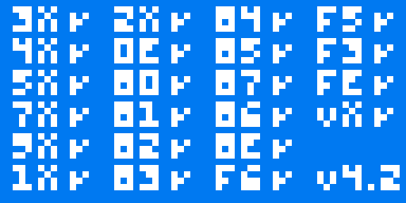

# chip8emu

A CHIP-8 interpreter written in C, rendered with [raylib](https://www.raylib.com/).


## Features

- Fetch-decode-execute loop covering the standard 35-opcode CHIP-8 instruction set
- 64x32 monochrome display stored as a bit-packed framebuffer, with XOR sprite drawing and `VF` collision detection
- Delay and sound timers, built-in hex font, and BCD / register store-load instructions
- 16-key hex keypad mapped onto the left side of a QWERTY keyboard
- Configurable quirks for ambiguous instructions (`BNNN` jump offset, `FX55`/`FX65` index behaviour) in `include/globals.h`

## Screenshots

| Corax+ opcode test (all passing) | IBM logo |
| --- | --- |
|  |  |
| **Chipquarium** | **Slippery Slope** |
|  |  |

## Building

Requires `gcc`, `make`, and raylib (e.g. `pacman -S raylib` on Arch, `brew install raylib` on macOS).

```sh
make
./main
```

The ROM to load is set in `src/main.c`; swap the `load_from_path(...)` line to try a different file in `roms/`.

## Controls

The CHIP-8 hex keypad maps to the keyboard like this:

```
CHIP-8 keypad      Keyboard
1 2 3 C            1 2 3 4
4 5 6 D            Q W E R
7 8 9 E            A S D F
A 0 B F            Z X C V
```

`Esc` or closing the window quits.

## Configuration

`include/globals.h` holds the window size and behaviour flags:

| Flag | Meaning |
| --- | --- |
| `jumpOffsetNew` | `1`: `BXNN` jumps to `XNN + VX` (CHIP-48/SUPER-CHIP). `0`: `BNNN` jumps to `NNN + V0` (original COSMAC VIP). |
| `oldStoreLoad` | `1`: `FX55`/`FX65` increment `I` (original behaviour). `0`: `I` is left unchanged. |
| `debug` | `1` enables verbose `debugf` tracing. |

## ROMs

The ROMs in `roms/` are third-party programs included for testing and belong to their respective authors. The test ROMs (`1-chip8-logo`, `3-corax+`, `6-keypad`) come from Timendus' [CHIP-8 test suite](https://github.com/Timendus/chip8-test-suite).
